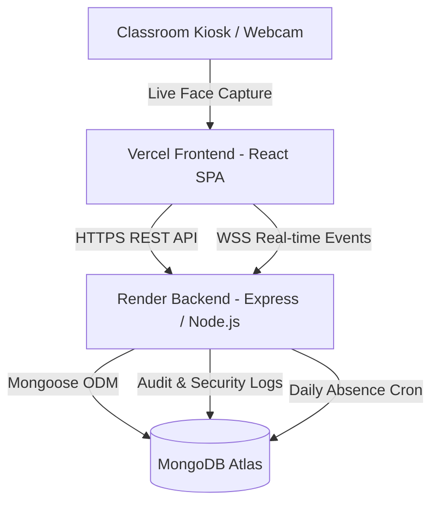

# BIT Smart Attendance System — Comprehensive Project Documentation

---

## 1. Executive Summary

The **BIT Smart Attendance System** is an enterprise-grade, cloud-deployed biometric attendance and academic administration platform engineered for **Bannari Amman Institute of Technology (BIT)**. 

The platform modernizes institutional attendance tracking by combining:
- **Biometric Face Recognition & Kiosk Scanning** (webcam/edge face recognition with anti-spoofing heuristics and sub-second matching).
- **Four-Tier Role-Based Access Control (RBAC)**: Primary Admin, Moderator, Faculty, and Student portals.
- **Enterprise Bulk Import/Export Hub**: Excel spreadsheet ingest with real-time preview, inline error editing, and formula injection sanitization.
- **Automated Institutional Standards Enforcement**: Auto-generation of institutional emails (`firstname.dept@bitsathy.ac.in`), roll number format validations (`7376...`), and automatic department/section provisioning.
- **Dedicated Moderator Audit Logging**: Complete immutable audit trail of all moderator operations accessible exclusively to Primary Admins.
- **Real-Time WebSocket Architecture**: Instant live-streamed kiosk punch events, room attendance sessions, and device telemetry via Socket.IO.
- **Modern Cloud Architecture**: Decoupled deployment with a React + Vite Single Page Application on **Vercel** and an Express + TypeScript + MongoDB Atlas API service on **Render**.

---

## 2. Problem Statement & Background

### 2.1 The Traditional Attendance Problem
1. **Instructional Time Wastage**: In classrooms with 60–70 students, manual roll calls consume 10 to 15 minutes of every lecture hour—wasting up to 20% of teaching time.
2. **Proxy Attendance & Identity Fraud**: Manual paper sign-in sheets and shared RFID/smart cards allow students to mark attendance for absent peers without verification.
3. **Delayed Action on Low Attendance**: Institutional rules mandate that students maintain a minimum of 75% attendance to qualify for examinations. With paper registers or batch-updated systems, students and counselors are only notified at the end of the semester when it is already too late for corrective action.
4. **Administrative Bottlenecks in Data Onboarding**: At the start of every academic semester, enrolling hundreds of students across multiple branches, sections, and subject allocations using manual form inputs leads to severe data inconsistency, typo errors, and duplicate entries.
5. **Lack of Operational Accountability**: When administrative clerks or assistant coordinators manage records, there is often no audit trail showing who created, altered, or deleted academic records.

### 2.2 The Solution
The **BIT Smart Attendance System** solves these challenges end-to-end:
- **Zero-Friction Kiosk Scans**: Eliminates manual roll calls. Students walk up to a classroom kiosk or webcam terminal; their facial landmarks are detected, verified, and logged within milliseconds.
- **Automated Data Integrity Rules**: Enforces strict primary keys, roll number rules, and auto-derives college email addresses (`name.dept@bitsathy.ac.in`) automatically.
- **Interactive Excel Import with Inline Correction**: Administrators upload an entire class list in Excel format. If errors exist (e.g. invalid email format, missing department), the admin can **fix the cell directly inside the preview table** and instantly re-validate without re-uploading the spreadsheet.
- **Multi-Role Governance**: Full segregation of responsibilities with automated moderator activity logging.
- **Live Notifications & Kiosk Heartbeats**: Instant alerts for students falling below 75% attendance, immediate real-time dashboard updates for faculty, and live device status tracking.

---

## 3. System Architecture & Tech Stack



### 3.1 Technology Stack Details

| Layer | Technologies Used | Description & Purpose |
| :--- | :--- | :--- |
| **Frontend UI** | React 18, Vite, TypeScript | Ultra-responsive Single Page Application (SPA) |
| **Styling** | Tailwind CSS, Lucide Icons | MNC Enterprise Dark Theme (`#0b0f17` palette) |
| **Data Viz** | Recharts | Departmental trends, student attendance analytics |
| **Biometrics** | Face-API.js (TensorFlow.js) | Client-side facial landmark detection and 128D embedding extraction |
| **Excel Ingest** | SheetJS (`xlsx`) | Client & server spreadsheet parsing & styling |
| **Backend API** | Node.js, Express, TypeScript | Modular REST API service with strict typing |
| **Database** | MongoDB Atlas, Mongoose ODM | Cloud NoSQL database with indexing and schema validation |
| **Real-time** | Socket.IO | Bidirectional WebSocket communication for kiosk punches and alerts |
| **Scheduling** | `node-cron` | Automated midnight absence logging and low-attendance alerts |
| **Security** | Helmet, CORS, Rate-Limiting, Bcrypt, JWT | Hardened API defense and token-based RBAC |
| **Cloud Hosting** | **Vercel** (Frontend) + **Render** (Backend) | Global edge CDN frontend + auto-scaling cloud container backend |

---

## 4. Comprehensive Feature Breakdown

### 4.1 Role-Based Access Control (RBAC)

The system provides 4 distinct user roles with strict server-side authorization middleware (`authorize(...)`):

```
                        [ PRIMARY ADMIN ]
                               │
               ┌───────────────┴───────────────┐
               ▼                               ▼
       [ MODERATOR ]                  [ PRIMARY ADMIN ]
    (Full access except              (Can create Admins
    creating Moderators)             & view Mod Logs)
               │
        ┌──────┴──────┐
        ▼             ▼
   [ FACULTY ]   [ STUDENT ]
```

1. **Primary Admin**:
   - Full institutional ownership.
   - Manage Departments, Sections, Subjects, Faculty, and Students.
   - Bulk Excel Import / Export.
   - **Admin Creation Modal**: Can elevate or create new Primary Admins.
   - **Moderator Audit Logs**: Dedicated viewer that filters and tracks every action executed by Moderators.
2. **Moderator**:
   - Operational parity with Admin: can manage students, faculty, classes, timetables, and bulk imports.
   - **Strict Restriction**: Cannot create, edit, or delete another Moderator or Admin account.
   - Every mutating request logs an immutable record with IP address, timestamp, and target entity.
3. **Faculty**:
   - View assigned subject allocations and class rosters.
   - Real-time interactive class attendance marking (Present, Absent, Late, Excused).
   - Resolve attendance dispute requests submitted by students.
   - Generate subject-wise attendance analytics and report cards.
4. **Student**:
   - Personal attendance dashboard with overall percentage and subject-wise breakdown.
   - Visual alerts when attendance drops below the 75% institutional threshold.
   - Submit formal attendance dispute requests with explanation and proof.
   - View timetable and biometric enrollment status.

---

### 4.2 Biometric Face Recognition & Kiosk Center

- **Sidebar Navigation**: Dedicated **"Biometric Register"** tab accessible in the main navigation.
- **Split Tabbed Registry**:
  - **`Pending Registration` Tab**: Lists all students who have not yet enrolled their biometric face descriptors. Displays quick **"Register Face"** action buttons.
  - **`Registered` Tab**: Lists all enrolled students with verification timestamps, enrollment badges, and re-registration options.
- **Webcam Registration Modal**:
  - Real-time webcam feed with responsive face-mesh alignment guide.
  - Captures 128-dimensional facial landmark embeddings using MobileNet/SSD face detection models.
  - Stores biometric descriptors securely linked to the student record.
- **Live Kiosk Scanner**:
  - Full-screen classroom kiosk mode.
  - Instant face match against enrolled student descriptors.
  - Sub-second attendance verification: automatically logs the punch, displays student details, and plays audio-visual confirmation.
  - Broadcasts live punch event over Socket.IO to connected faculty and admin dashboards.

---

### 4.3 Automated Institutional Constraints & Smart Provisioning

To prevent data corruption, strict institutional rules are enforced:
1. **Primary Key Constraints**: Student Register Number and Roll Number must be unique and non-null.
2. **Institutional Roll Number Standard**: Must adhere to institutional prefixes (e.g. `7376...`).
3. **Automated Institutional Email Derivation**:
   - Format: `firstname.deptcode@bitsathy.ac.in` (e.g. `arun.cse@bitsathy.ac.in`, `priya.ece@bitsathy.ac.in`).
   - Standardized across both single student creation and bulk Excel importing.
4. **Dynamic Department & Section On-the-Fly Creation**:
   - When adding a student or importing a spreadsheet, if an entered Department or Section does not yet exist, the system does not crash or silently reject it.
   - Instead, it prompts the administrator: *"Department [NAME] does not exist. Would you like to create it?"* with an option to rename or approve on the spot.

---

### 4.4 Excel Bulk Import & Export Center with Inline Cell Editing

Located at `/admin/bulk-import`:
1. **Official Multi-Sheet Templates**:
   - Download pre-styled `.xlsx` templates for **Students**, **Faculty**, and **Course Allocations**.
   - Includes validation instructions, example rows, and forced text cell formats to prevent Excel from dropping leading zeros on phone numbers or register numbers.
2. **In-Memory Streaming (Zero Disk Leakage)**:
   - Uploaded files are processed purely in RAM using `multer.memoryStorage()`, ensuring temporary files never linger on cloud disks.
3. **Live Validation Preview**:
   - Rows are categorized into `Valid`, `Invalid`, or `Duplicate` (checked against both the spreadsheet and existing database records).
4. **Inline Row Correction (`PUT /api/v1/import/preview/:jobId/row`)**:
   - If a row has an error (e.g. invalid phone number, wrong year), the admin can **double-click and edit the cell directly inside the preview table**.
   - The system re-validates the single row on the server in real time and flips the badge to `Valid` without requiring the user to re-upload the file.
5. **Secure Export with Formula Injection Protection**:
   - Student and Faculty rosters can be exported to `.xlsx` or `.csv`.
   - Any cell starting with `=, +, -, @` is automatically escaped to prevent Excel Formula Injection (CSV/Formula Injection attack mitigation).

---

### 4.5 Dedicated Moderator Activity Audit Logs

- **Location**: Admin Settings &rarr; **Moderator Logs** tab.
- **Strict Visibility**: Only users with the `ADMIN` role can access this view (`authorize('ADMIN')`).
- **Telemetry Captured**:
  - Timestamp (IST / UTC).
  - Moderator Name & Email.
  - Action Category (`STUDENT_CREATED`, `STUDENT_UPDATED`, `BULK_IMPORT`, `TIMETABLE_CHANGE`, `DISPUTE_OVERRIDE`).
  - Target Entity ID & Name.
  - IP Address and User Agent.
  - Old Value vs. New Value diff.

---

### 4.6 Production Cloud Deployment Architecture

#### Frontend on Vercel
- **Project Structure**: Located in `frontend/`. Built with `vite build`.
- **SPA Deep Routing (`vercel.json`)**:
  ```json
  {
    "rewrites": [{ "source": "/(.*)", "destination": "/index.html" }]
  }
  ```
  Prevents 404 errors when refreshing client routes (`/admin/students`, `/faculty/attendance`).
- **Dynamic Endpoint Resolution**:
  - `VITE_API_URL` & `VITE_SOCKET_URL` set to `https://bit-biometric-backend.onrender.com`.
  - Automatically sanitizes trailing slashes.

#### Backend on Render
- **Live URL**: `https://bit-biometric-backend.onrender.com`
- **Health Check Route**: `GET /health` &rarr; returns `{"status":"UP","service":"BIT Smart Attendance Backend API"}`.
- **Dynamic Environment Resolution**: Automatically falls back to Render container environment variables when local monorepo `.env` is absent.
- **Production Package Dependencies**: `typescript` and type definitions included in `dependencies` so production `npm install && npm run build` compiles without missing `tsc`.
- **Render Blueprint (`render.yaml`)**: Root declarative blueprint for automated reproducible builds.

---

## 5. Summary of API Endpoints

| Method | Endpoint | Access | Purpose |
| :--- | :--- | :--- | :--- |
| `GET` | `/health` | Public | Render / load balancer health check |
| `POST` | `/api/v1/auth/login` | Public | Email/Password login, returns JWT token & user profile |
| `POST` | `/api/v1/auth/device-login` | Public | Kiosk / IoT device authentication |
| `GET` | `/api/v1/admin/dashboard` | Admin, Moderator | Total counts, live attendance percentages, alerts |
| `POST` | `/api/v1/admin/create-admin` | Admin only | Primary Admin creates another Admin |
| `GET` | `/api/v1/admin/moderator-logs` | Admin only | View audit trail of moderator actions |
| `POST` | `/api/v1/admin/students` | Admin, Moderator | Create student with auto-email & validation |
| `GET` | `/api/v1/admin/biometrics/pending` | Admin, Moderator | List students pending biometric registration |
| `POST` | `/api/v1/admin/biometrics/register` | Admin, Moderator | Save facial descriptor embeddings |
| `POST` | `/api/v1/attendance/recognize` | Device / Kiosk | Live biometric face matching & attendance punch |
| `POST` | `/api/v1/import/upload` | Admin only | In-memory parse & preview of Excel spreadsheet |
| `PUT` | `/api/v1/import/preview/:jobId/row` | Admin only | Inline fix of row data with live re-validation |
| `POST` | `/api/v1/import/confirm/:jobId` | Admin only | Commit validated rows to MongoDB database |
| `GET` | `/api/v1/import/export/students` | Admin only | Export sanitized `.xlsx`/`.csv` student records |
| `GET` | `/api/v1/faculty/classes` | Faculty | View assigned subjects and class timetables |
| `POST` | `/api/v1/faculty/attendance` | Faculty | Manual or batch attendance override |
| `GET` | `/api/v1/student/dashboard` | Student | Personal percentage, low attendance warnings |
| `POST` | `/api/v1/student/dispute` | Student | Submit formal attendance dispute |

---

## 6. How to Run the Project Locally

### Prerequisites
- Node.js >= 18
- MongoDB (running locally on port 27017 or MongoDB Atlas connection string)

### 1. Backend Setup
```bash
cd backend
npm install
# Ensure .env has:
# PORT=5000
# MONGODB_URI=mongodb://localhost:27017/bit-smart-attendance
# JWT_SECRET=your_jwt_secret
npm run dev
```
Backend runs at `http://localhost:5000`.

### 2. Frontend Setup
```bash
cd frontend
npm install
npm run dev
```
Frontend runs at `http://localhost:3000` (proxies `/api` and `/socket.io` to `http://localhost:5000`).

---

## 7. Current Project Status

- [x] Full RBAC implementation (Admin, Moderator, Faculty, Student).
- [x] Biometric face capture, recognition, and kiosk scanning.
- [x] Dedicated Biometric Register tab (Pending vs Registered).
- [x] Excel Bulk Import with inline row correction & live re-validation.
- [x] Excel Export with Formula Injection protection.
- [x] Institutional email derivation (`name.dept@bitsathy.ac.in`).
- [x] Primary key & roll number validation (`7376...`).
- [x] Dynamic department/section creation on-the-fly.
- [x] Moderator activity audit logs (Admin exclusive).
- [x] Admin creation modal.
- [x] Backend live on Render: `https://bit-biometric-backend.onrender.com`.
- [x] Frontend prepared with `vercel.json` and deployed on Vercel.
- [x] All TypeScript builds pass with `0 errors`.
