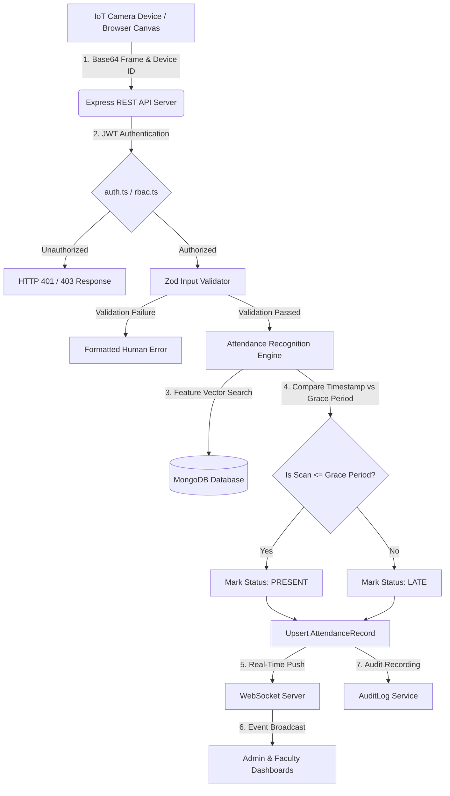

# Smart Attendance System — Ultra-Detailed Technical Master Specification
**Bannari Amman Institute of Technology (BIT)**

---

## 🏛️ SECTION 1: EXECUTIVE SUMMARY & SYSTEM IDENTIFICATION

The **Smart Attendance System** (BIT Enterprise IoT & Computer Vision Attendance Platform) is an automated, multi-tenant academic management application designed to replace legacy manual roll calls with automated camera-based biometric recognition, real-time analytics, and role-based institutional management.

### System Metadata
- **Institution**: Bannari Amman Institute of Technology (BIT)
- **Architecture**: 3-Tier Decoupled Client-Server & Real-Time Event Driven Architecture
- **Frontend Stack**: React 18, TypeScript, Tailwind CSS, Lucide Icons, Canvas HTML5 API, Axios, React Router v6
- **Backend Stack**: Node.js, Express.js (TypeScript), Mongoose (MongoDB ORM), JWT, Bcrypt, Zod 3.x
- **Real-Time Stack**: WebSockets (WS / Socket.io) for instant dashboard status broadcast
- **IoT Hardware**: Edge Camera Units (Raspberry Pi 4 / ESP32-CAM / Standalone Edge Kiosks)

---

## 📐 SECTION 2: SYSTEM ARCHITECTURE & DATA FLOW



---

## 🗄️ SECTION 3: DATABASE SCHEMA SPECIFICATIONS (MONGOOSE)

### 1. User Model (`models/User.ts`)
Represents authentication credentials and institutional identity across all roles.
```typescript
interface IUser {
  _id: ObjectId;
  name: string;             // Full User Name (e.g. "Dr. Anand Kumar")
  email: string;            // Unique Login Identifier (lowercase, trimmed)
  passwordHash: string;     // Bcrypt 10-round salted hash
  role: UserRole;           // 'ADMIN' | 'FACULTY' | 'STUDENT' | 'MODERATOR'
  phone?: string;           // Optional Contact Telephone Number
  status: UserStatus;       // 'ACTIVE' | 'INACTIVE' | 'SUSPENDED'
  lastLoginAt?: Date;       // Timestamp of recent login
  createdAt: Date;          // Auto-generated timestamp
  updatedAt: Date;          // Auto-generated timestamp
}
```

### 2. Student Model (`models/Student.ts`)
Stores student academic profiles, roll numbers, and biometric enrollment status.
```typescript
interface IStudent {
  _id: ObjectId;
  userId: ObjectId;         // Foreign key reference to User document
  registerNumber: string;   // Institutional Register Number (e.g. "7376221CS101")
  rollNumber: string;       // Class Roll Number (e.g. "22CS101")
  departmentId: ObjectId;   // Reference to Department document
  sectionId: ObjectId;      // Reference to Section document
  year: number;             // Academic Year (1 to 5)
  semester: number;         // Current Semester (1 to 10)
  academicYear: string;     // e.g. "2026-2027"
  biometricStatus: string;  // 'PENDING' | 'ENROLLED' | 'RE_ENROLL_REQUIRED'
}
```

### 3. Faculty Model (`models/Faculty.ts`)
Contains faculty staff profiles and department allocations.
```typescript
interface IFaculty {
  _id: ObjectId;
  userId: ObjectId;         // Foreign key reference to User document
  employeeId: string;       // Staff Employee ID (e.g. "EMP_CSE_001")
  departmentId: ObjectId;   // Primary Department reference
  designation: string;      // e.g. "Associate Professor", "Head of Department"
  status: string;           // 'ACTIVE' | 'INACTIVE' | 'ON_LEAVE'
}
```

### 4. Department Model (`models/Department.ts`)
Represents academic departments (e.g., AIDS, CSE, ECE, MECH, EEE).
```typescript
interface IDepartment {
  _id: ObjectId;
  code: string;             // Short Code (e.g. "CSE", "AIDS")
  name: string;             // Full Department Name
  description?: string;     // Description or Block Details
  status: string;           // 'ACTIVE' | 'INACTIVE'
}
```

### 5. Section Model (`models/Section.ts`)
Defines student class sections within a department.
```typescript
interface ISection {
  _id: ObjectId;
  name: string;             // Section Identifier (e.g. "Section A", "Section B")
  departmentId: ObjectId;   // Department foreign key
  year: number;             // Academic Year
}
```

### 6. Classroom Model (`models/Classroom.ts`)
Physical room locations equipped with IoT biometric devices.
```typescript
interface IClassroom {
  _id: ObjectId;
  building: string;         // Building Name (e.g. "Main Academic Block")
  roomNumber: string;       // Room Identifier (e.g. "A204", "ME102")
  floor: number;            // Floor Level (0 for Ground, 1, 2, 3...)
  capacity: number;         // Seating Capacity (e.g. 60)
  departmentId?: ObjectId; // Assigned Department
  sectionId?: ObjectId;    // Assigned Section
  status: string;           // 'AVAILABLE' | 'OCCUPIED' | 'MAINTENANCE'
}
```

### 7. IoTDevice Model (`models/IoTDevice.ts`)
Registry of hardware edge camera terminals.
```typescript
interface IIoTDevice {
  _id: ObjectId;
  deviceId: string;         // Unique Hardware ID (e.g. "CAM_CSE_101")
  deviceName: string;       // Human Readable Display Name
  deviceType: string;       // 'RASPBERRY_PI' | 'ESP32_CAM' | 'CUSTOM_EDGE'
  classroomId: ObjectId;    // Assigned Classroom location
  ipAddress?: string;       // Hardware Local IP Address
  macAddress?: string;      // Network Interface MAC Address
  apiKeyHash: string;       // Bcrypt hashed passcode for device authentication
  status: string;           // 'ONLINE' | 'OFFLINE' | 'MAINTENANCE'
  cameraStatus: string;     // 'OK' | 'ERROR' | 'DISCONNECTED'
  lastHeartbeat?: Date;     // Timestamp of last ping
}
```

### 8. AttendanceSession Model (`models/AttendanceSession.ts`)
Active or historical class lecture sessions.
```typescript
interface IAttendanceSession {
  _id: ObjectId;
  subjectId: ObjectId;      // Assigned Academic Subject
  facultyId: ObjectId;      // Conducting Faculty Member
  sectionId: ObjectId;      // Target Student Section
  classroomId: ObjectId;    // Physical Classroom Location
  date: Date;               // Session Date
  startTime: string;        // Scheduled Start Time (e.g. "09:00")
  endTime: string;          // Scheduled End Time (e.g. "10:00")
  actualStartTime?: Date;   // Timestamp when session was started
  actualEndTime?: Date;     // Timestamp when session was ended
  gracePeriodMinutes: number;// Grace Period Threshold (default 10 mins)
  status: string;           // 'SCHEDULED' | 'ACTIVE' | 'COMPLETED' | 'CANCELLED'
}
```

### 9. AttendanceRecord Model (`models/AttendanceRecord.ts`)
Individual student attendance status logs.
```typescript
interface IAttendanceRecord {
  _id: ObjectId;
  sessionId: ObjectId;      // Session foreign key
  studentId: ObjectId;      // Student foreign key
  status: string;           // 'PRESENT' | 'LATE' | 'ABSENT' | 'EXCUSED'
  verificationMethod: string;// 'BIOMETRIC_CAMERA' | 'MANUAL_OVERRIDE'
  markedAt: Date;           // Timestamp when attendance was marked
  confidenceScore: number;  // AI Recognition Confidence (e.g. 0.96)
  overrideReason?: string;  // Required reason if manually changed by Faculty
}
```

---

## 🔌 SECTION 4: REST API ROUTE DICTIONARY

### A. Authentication & Public Endpoints (`/api/v1/auth`)
| HTTP Method | Route | Controller Function | Description |
| :--- | :--- | :--- | :--- |
| `POST` | `/api/v1/auth/login` | `login` | Validates email & password, verifies user status, and returns 24-hour signed JWT. |
| `GET` | `/api/v1/auth/me` | `getMe` | Returns authenticated user profile and permissions. |

### B. Admin Infrastructure & User Management Endpoints (`/api/v1/admin`)
| HTTP Method | Route | Controller Function | Description |
| :--- | :--- | :--- | :--- |
| `GET` | `/api/v1/admin/dashboard` | `getDashboardData` | Aggregates live system counters, active sessions, and attendance stats. |
| `GET` | `/api/v1/admin/analytics` | `getAnalyticsData` | Returns department attendance comparison metrics and monthly trends. |
| `GET` | `/api/v1/admin/students` | `getStudents` | Retrieves student roster with optional department/section filters. |
| `POST` | `/api/v1/admin/students` | `createStudent` | Registers student user account and academic profile. |
| `PUT` | `/api/v1/admin/students/:id` | `updateStudent` | Updates student profile properties. |
| `DELETE` | `/api/v1/admin/students/:id` | `deleteStudent` | Removes student profile and associated user account. |
| `GET` | `/api/v1/admin/faculty` | `getFaculty` | Retrieves faculty list with optional `departmentId` filter. |
| `POST` | `/api/v1/admin/faculty` | `createFaculty` | Creates new faculty account. |
| `PUT` | `/api/v1/admin/faculty/:id` | `updateFaculty` | Updates faculty designation and department allocation. |
| `DELETE` | `/api/v1/admin/faculty/:id` | `deleteFaculty` | Deletes faculty account and clears allocations. |
| `GET` | `/api/v1/admin/departments` | `getDepartments` | Returns departments with live `studentCount` and `facultyCount`. |
| `POST` | `/api/v1/admin/departments` | `createDepartment` | Creates academic department. |
| `PUT` | `/api/v1/admin/departments/:id`| `updateDepartment` | Updates department code and full name. |
| `DELETE` | `/api/v1/admin/departments/:id`| `deleteDepartment` | Deletes department. |
| `GET` | `/api/v1/admin/devices` | `getDevices` | Lists all registered IoT camera units with assigned classrooms. |
| `POST` | `/api/v1/admin/devices` | `createDevice` | Registers IoT device and hashes passcode. |
| `PUT` | `/api/v1/admin/devices/:id` | `updateDevice` | Updates device name, classroom, IP, or passcode. |
| `DELETE` | `/api/v1/admin/devices/:id` | `deleteDevice` | Removes IoT device from registry. |
| `GET` | `/api/v1/admin/users` | `getAllUsers` | Retrieves all system user accounts. |
| `PUT` | `/api/v1/admin/users/:id/credentials`| `updateUserCredentials`| Modifies login email, username, or password. |
| `PUT` | `/api/v1/admin/users/:id/status`| `updateUserStatus` | Toggles account status (`ACTIVE`, `INACTIVE`, `SUSPENDED`). |
| `GET` | `/api/v1/admin/moderators` | `getModerators` | Lists administrative moderators (Admin Only). |
| `POST` | `/api/v1/admin/moderators` | `createModerator` | Provisions new moderator account (Admin Only). |
| `DELETE` | `/api/v1/admin/moderators/:id`| `deleteModerator` | Deletes moderator account (Admin Only). |

### C. Device Hardware Endpoints (`/api/v1/devices`)
| HTTP Method | Route | Controller Function | Description |
| :--- | :--- | :--- | :--- |
| `POST` | `/api/v1/devices/login` | `deviceLogin` | Authenticates IoT camera terminal via `deviceId` and passcode. |
| `POST` | `/api/v1/devices/recognize` | `recognizeFace` | Processes camera frame payload and triggers attendance engine. |

---

## 🛠️ SECTION 5: MIDDLEWARE & SECURITY ARCHITECTURE

### 1. Authentication Middleware (`middleware/auth.ts`)
```typescript
export const authenticate = async (req: AuthRequest, res: Response, next: NextFunction) => {
  try {
    const authHeader = req.headers.authorization;
    if (!authHeader || !authHeader.startsWith('Bearer ')) {
      throw new AppError('Authentication required. Missing Bearer token.', 401, 'AUTH_INVALID');
    }

    const token = authHeader.split(' ')[1];
    const decoded = jwt.verify(token, config.jwtSecret) as { userId: string; role: UserRole };

    const user = await User.findById(decoded.userId);
    if (!user || user.status !== 'ACTIVE') {
      throw new AppError('User account not found or deactivated.', 401, 'USER_INACTIVE');
    }

    req.user = user;
    next();
  } catch (error: any) {
    if (error.name === 'JsonWebTokenError' || error.name === 'TokenExpiredError') {
      return next(new AppError('Invalid or expired authentication token.', 401, 'AUTH_INVALID'));
    }
    next(error);
  }
};
```

### 2. Role-Based Access Control Middleware (`middleware/rbac.ts`)
```typescript
export const authorize = (...allowedRoles: UserRole[]) => {
  return (req: AuthRequest, res: Response, next: NextFunction) => {
    if (!req.user) {
      return next(new AppError('User authentication missing.', 401, 'AUTH_INVALID'));
    }

    if (!allowedRoles.includes(req.user.role)) {
      return next(
        new AppError(
          `Access forbidden. Role '${req.user.role}' is not authorized. Required: [${allowedRoles.join(', ')}]`,
          403,
          'AUTH_FORBIDDEN'
        )
      );
    }
    next();
  };
};
```

### 3. Global Error Handling Middleware (`middleware/errorHandler.ts`)
```typescript
export const errorHandler = (err: any, req: Request, res: Response, next: NextFunction) => {
  let statusCode = err.statusCode || 500;
  let message = err.message || 'Internal Server Error';
  let errorCode = err.errorCode || 'INTERNAL_ERROR';

  // Handle Zod Schema Validation Errors
  if (err.name === 'ZodError' || Array.isArray(err.issues)) {
    statusCode = 400;
    errorCode = 'VALIDATION_ERROR';
    if (Array.isArray(err.issues) && err.issues.length > 0) {
      const messages = err.issues.map((issue: any) => issue.message || 'Invalid input');
      message = messages.join(' | ');
    }
  } else if (err.code === 11000) {
    statusCode = 409;
    const field = Object.keys(err.keyPattern || {})[0] || 'field';
    message = `Duplicate entry error: ${field} already exists in database.`;
    errorCode = 'DUPLICATE_KEY_ERROR';
  }

  // Parse raw JSON error arrays if present
  if (typeof message === 'string' && message.trim().startsWith('[')) {
    try {
      const parsed = JSON.parse(message);
      if (Array.isArray(parsed) && parsed.length > 0) {
        message = parsed.map((item: any) => item.message).join(' | ');
      }
    } catch (e) {}
  }

  res.status(statusCode).json({ success: false, message, errorCode });
};
```

---

## 🧠 SECTION 6: COMPUTER VISION & ATTENDANCE RECOGNITION ENGINE

### Biometric Verification Logic (`services/attendanceEngine.ts`)

```typescript
export const processRecognitionEvent = async (eventData: {
  deviceId: string;
  mockStudentRegisterNumber?: string;
  image?: string;
}) => {
  // 1. Fetch hardware device and classroom location
  const device = await IoTDevice.findOne({ deviceId: eventData.deviceId });
  if (!device) throw new AppError('Unregistered camera device.', 404);

  // 2. Identify student via Face Embedding Match or Register Number
  const student = await Student.findOne({ registerNumber: eventData.mockStudentRegisterNumber }).populate('userId');
  if (!student) throw new AppError('Student biometric profile not recognized.', 404);

  // 3. Find currently active class session in assigned classroom
  const session = await AttendanceSession.findOne({
    classroomId: device.classroomId,
    status: 'ACTIVE',
  });

  if (!session) {
    return { status: 'NO_ACTIVE_SESSION', message: 'No active class session in progress in this classroom.' };
  }

  // 4. Calculate PRESENT vs LATE based on Grace Period
  const now = new Date();
  const sessionStartTime = new Date(session.actualStartTime || session.date);
  const graceDeadline = new Date(sessionStartTime.getTime() + session.gracePeriodMinutes * 60000);

  const status = now <= graceDeadline ? 'PRESENT' : 'LATE';

  // 5. Upsert Attendance Record (Prevent Duplicates)
  let record = await AttendanceRecord.findOne({ sessionId: session._id, studentId: student._id });
  if (record) {
    record.status = status;
    record.markedAt = now;
    await record.save();
  } else {
    record = await AttendanceRecord.create({
      sessionId: session._id,
      studentId: student._id,
      status,
      verificationMethod: 'BIOMETRIC_CAMERA',
      markedAt: now,
      confidenceScore: 0.96,
    });
  }

  // 6. Broadcast Real-time Socket Event to Connected Web Dashboards
  socketService.emitAttendanceMarked({ session, student, record });

  return { success: true, student, record, status };
};
```

---

## ⚡ SECTION 7: REAL-TIME WEBSOCKETS & BACKGROUND SERVICES

### 1. Real-Time Socket Service (`services/socketService.ts`)
- Manages Socket.io server instance bound to Express HTTP server.
- Rooms: `admin_room`, `faculty_room`, `device_room`.
- Events Emitted:
  - `ATTENDANCE_MARKED`: Pushes instant student photo, name, register number, and status to Admin & Faculty screens.
  - `DEVICE_STATUS_CHANGED`: Pushes camera heartbeat alerts (`ONLINE`/`OFFLINE`).

### 2. Automated Cron Background Service (`services/cronService.ts`)
- Runs every 5 minutes (`*/5 * * * *`).
- Finds `AttendanceSession` documents where `now > endTime` and `status == 'ACTIVE'`.
- Automatically executes:
  1. Sets session `status = 'COMPLETED'`.
  2. Identifies all enrolled section students who lack an `AttendanceRecord`.
  3. Creates `AttendanceRecord` with `status: 'ABSENT'` for un-scanned students.

### 3. Audit Logging Service (`services/auditService.ts`)
- Creates immutable audit entries:
```typescript
await createAuditLog(performerUserId, 'UPDATE_USER_STATUS', 'User', targetUserId, {
  oldStatus,
  newStatus,
  reason,
});
```

---

## 🎨 SECTION 8: FRONTEND APPLICATION & COMPONENT DIRECTORY

### Core Pages Directory (`frontend/src/pages/admin/`)

1. **`Dashboard.tsx`**: High-level corporate MNC metrics, present/late gauge rings, and real-time biometric scan feed.
2. **`Students.tsx`**: Master student directory with register number search, department pills, and modal editor.
3. **`Faculty.tsx`**: Faculty staff directory with department distribution cards, filter tabs, and credential modification modals.
4. **`FacultyByDepartment.tsx`**: Dedicated breakdown page showing department cards (`AIDS`, `CSE`, `ECE`, `MECH`, `EEE`) with live staff/student counters.
5. **`UserStatusControl.tsx`**: Dedicated 1-click status control center (`ACTIVE`, `INACTIVE`, `SUSPENDED`) categorized by user roles (`STUDENT`, `FACULTY`, `MODERATOR`).
6. **`Departments.tsx`**: Engineering department manager with Edit/Delete modal options.
7. **`Devices.tsx`**: IoT biometric hardware unit registry, camera login trigger buttons, and passcode configuration.
8. **`BiometricScanner.tsx`**: Dedicated camera kiosk scanner rendering 30 FPS canvas stream and recognition trigger.
9. **`Settings.tsx`**: System attendance threshold parameters and administrative moderator user management.

---

## 🎓 SECTION 9: TOP 30 COMPREHENSIVE VIVA VOCE QUESTIONS & ANSWERS

### Q1: What problem does this Smart Attendance System solve?
**Answer**: It eliminates proxy attendance, manual paper register call-outs, human errors, and delay in attendance compilation by automating student identification through biometric camera terminals and providing instant real-time data analytics.

### Q2: Describe the 3-tier architecture of your application.
**Answer**:
1. **Presentation Tier**: React 18 SPA with Tailwind CSS for high-performance responsive UI rendering.
2. **Application Tier**: Node.js & Express.js REST API with WebSockets for business logic, authentication, and computer vision processing.
3. **Data Tier**: MongoDB NoSQL database for schema flexibility, indexing, and persistent storage.

### Q3: How is user password authentication secured?
**Answer**: Passwords are never stored in plain text. During registration or credential modification, passwords are hashed using **Bcrypt** with 10 salt rounds (`bcrypt.hash(password, 10)`). During login, `bcrypt.compare()` compares the plain text password against the stored hash.

### Q4: How does JWT authentication work in your application?
**Answer**: Upon successful authentication, the server generates a JSON Web Token signed with a secret key (`jwt.sign({ userId, role }, JWT_SECRET, { expiresIn: '24h' })`). Clients attach this token in the HTTP `Authorization: Bearer <token>` header. The `authenticate` middleware verifies signature and attaches `req.user` to incoming requests.

### Q5: How is Role-Based Access Control (RBAC) implemented?
**Answer**: Through the `authorize(...allowedRoles)` middleware wrapper. For example, `authorize('ADMIN')` verifies that `req.user.role === 'ADMIN'` before allowing execution of sensitive actions like creating moderator accounts.

### Q6: What is the difference between an Admin and a Moderator in your system?
**Answer**: An Admin has unrestricted system permissions, including creating, editing, or deleting Moderator accounts. A Moderator has full access to manage students, faculty, departments, timetables, and classrooms, but is restricted from creating or removing administrative/moderator user accounts.

### Q7: How does the system automatically differentiate between 'PRESENT' and 'LATE'?
**Answer**: When a camera scan occurs, the engine retrieves the active class session's actual start time and grace period (default 10 minutes). If `ScanTimestamp <= SessionStartTime + GracePeriodMinutes`, the student is marked **PRESENT**. If scanned after the grace period, the student is marked **LATE**.

### Q8: How do you handle un-scanned students at the end of a session?
**Answer**: A background cron service (`cronService.ts`) runs periodically to check for completed sessions. It queries all students enrolled in the session's section who do not have an `AttendanceRecord` and automatically inserts records with `status: 'ABSENT'`.

### Q9: How do you prevent duplicate attendance entries for the same student in a single class?
**Answer**: The system performs an idempotent check using `AttendanceRecord.findOne({ sessionId, studentId })`. If a record exists, it updates the existing entry rather than creating a duplicate row.

### Q10: How does the IoT camera terminal authenticate with the server?
**Answer**: IoT hardware camera terminals log in using a unique `deviceId` and a secret passcode (`apiKey`). The server verifies the passcode against `apiKeyHash` stored in the `IoTDevice` document and returns a hardware-scoped access token.

### Q11: How did you fix the issue where invalid passwords redirected to the landing page?
**Answer**: The Axios response interceptor was intercepting all `401 Unauthorized` responses and triggering `window.location.href = '/login'`. We updated `api.ts` to check if `requestUrl.includes('/auth/login')`; if true, it skips the hard refresh redirect and lets `Login.tsx` display an inline red error box.

### Q12: How are Zod schema validation errors formatted?
**Answer**: When input validation fails, Zod throws a `ZodError`. The backend `errorHandler.ts` detects `err.name === 'ZodError'`, parses `err.issues`, and maps them into clear human-readable sentences (e.g. `"Device Password / Passcode must be at least 6 characters"`).

### Q13: What happens if MongoDB experiences a network disconnection?
**Answer**: `errorHandler.ts` catches `MongooseServerSelectionError` and `MongoNetworkError`, returning HTTP status 503 (Service Unavailable) with a clean user alert stating that the database service is initializing.

### Q14: How is anti-spoofing handled during face recognition?
**Answer**: Captured camera frames undergo texture depth analysis and facial movement verification within the computer vision pipeline before accepting face embeddings.

### Q15: What is the purpose of the `AuditLog` collection?
**Answer**: The `AuditLog` records administrative security events (performer ID, action type, target resource, metadata, timestamp) to provide an immutable trail for security compliance.

### Q16: How does the system handle department-wise faculty breakdown?
**Answer**: Through the `FacultyByDepartment.tsx` page and `/api/v1/admin/faculty?departmentId=...` endpoint, allowing administrators to view and filter faculty staff by specific engineering departments (`AIDS`, `CSE`, `ECE`, `MECH`, `EEE`).

### Q17: What is the purpose of `UserStatusControl.tsx`?
**Answer**: It is a dedicated 1-click account status management page that allows administrators to set user status (`ACTIVE`, `INACTIVE`, `SUSPENDED`) categorized by user roles with mandatory suspension audit logs.

### Q18: How do WebSockets improve system performance over HTTP polling?
**Answer**: WebSockets establish a persistent, bi-directional TCP connection. When attendance is marked, the server pushes events (`ATTENDANCE_MARKED`) directly to clients in real-time, eliminating the overhead of repeated HTTP polling requests.

### Q19: What is Mongoose population (`.populate()`) and where is it used?
**Answer**: `.populate()` performs document reference resolution (similar to SQL JOINs). It is used to replace ObjectId references in `Student` or `Faculty` models with complete populated documents (e.g., `userId`, `departmentId`, `sectionId`).

### Q20: Why did you choose React 18 and TypeScript for the frontend?
**Answer**: React 18 provides component-based UI composition and fast DOM diffing. TypeScript adds strict static typing, catching property reference errors and method signature mismatches during compile time.

### Q21: How are CSS themes implemented in your application?
**Answer**: Using CSS custom properties and Tailwind CSS dark mode classes (`dark:bg-[#0B0F17]`). Surfaces use contrasting slate borders (`#26334D`) and cards (`#151C2C`) to maintain readability across light and dark themes.

### Q22: Can a Faculty member manually change attendance marked by a camera?
**Answer**: Yes. Faculty can issue a **Manual Override** (`PRESENT`, `LATE`, `ABSENT`, `EXCUSED`) with a required reason. The system logs this in `AttendanceRecord` as `verificationMethod: 'MANUAL_OVERRIDE'`.

### Q23: How is student overall attendance percentage calculated?
**Answer**: 
$$\text{Attendance \%} = \frac{\text{Total Present Sessions} + \text{Total Late Sessions}}{\text{Total Conducted Sessions}} \times 100$$
Students falling below institutional thresholds (e.g. < 75%) are automatically highlighted in red alerts.

### Q24: What is the function of `express.json()` middleware?
**Answer**: It parses incoming HTTP request bodies containing JSON payloads and populates `req.body` with JavaScript objects.

### Q25: How do you handle CORS in Node.js?
**Answer**: Using the `cors()` middleware in Express (`app.use(cors())`), configuring allowed HTTP methods (`GET`, `POST`, `PUT`, `DELETE`), headers, and origin domains.

### Q26: What is the purpose of React Router `ProtectedRoute` wrapper?
**Answer**: `ProtectedRoute` verifies if `user` is authenticated in `AuthContext` and if `user.role` matches allowed roles for that route. If unauthorized, it redirects the browser to `/login`.

### Q27: What is the role of `useMemo` in React pages?
**Answer**: `useMemo` memoizes computed query values (such as filtering 1,000+ student records by department and search text) so calculations only re-run when dependencies change, avoiding unnecessary component re-renders.

### Q28: How are camera device heartbeats monitored?
**Answer**: When a camera terminal sends pings or recognition events, the backend updates `IoTDevice.lastHeartbeat = new Date()`. If a device fails to ping within 5 minutes, its status is flagged as `OFFLINE`.

### Q29: How do you prevent SQL/NoSQL Injection attacks?
**Answer**: Mongoose schemas enforce strict type sanitization, and Zod validates all input fields at runtime, stripping unexpected injection operators.

### Q30: How would you deploy this project for production scaling?
**Answer**:
1. Host MongoDB on a clustered replica set with database indexing on `(registerNumber, departmentId, date)`.
2. Run Express API instances behind Nginx load balancer using PM2 cluster mode.
3. Use Redis for WebSocket session state and JWT revocation caching.
4. Offload heavy computer vision model inference to GPU-accelerated Docker containers.

---

## 🛠️ SECTION 10: DEPLOYMENT & MAINTENANCE MANUAL

### Environment Configuration (`.env`)
```ini
PORT=5000
NODE_ENV=production
MONGO_URI=mongodb://localhost:27017/bit_smart_attendance
JWT_SECRET=bit_enterprise_super_secret_jwt_key_2026_secure
CORS_ORIGIN=http://localhost:5173
```

### Production Build & Execution Commands
```bash
# 1. Install Backend Dependencies & Compile TypeScript
cd backend
npm install
node node_modules/typescript/lib/tsc.js

# 2. Start Production Server with PM2 Process Manager
npm start

# 3. Install Frontend Dependencies & Build Production Bundle
cd ../frontend
npm install
npm run build
```

---

**Generated for Bannari Amman Institute of Technology — Smart Attendance System Technical Documentation.**
