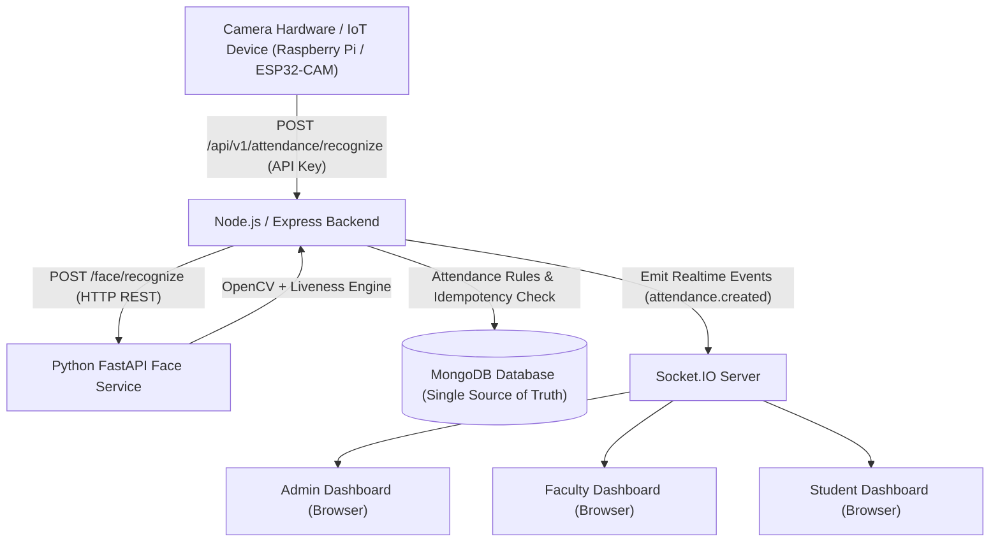

# BIT Smart Attendance System - System Architecture

## System Components

1. **Edge IoT Node (Raspberry Pi / ESP32-CAM)**
   - Captures camera frames and transmits event payloads to Node.js backend with device credentials (`x-device-id`, `x-api-key`).
   - Sends periodic heartbeat pings every 60 seconds to maintain `ONLINE` status.

2. **Node.js / Express Backend API**
   - Single point of business logic control.
   - Enforces JWT Authentication, RBAC (`ADMIN`, `FACULTY`, `STUDENT`), device authentication, and timetable/session validity.
   - Houses `AttendanceEngine` for atomic attendance creation and MongoDB compound index idempotency enforcement (`studentId + sessionId`).

3. **Python Face Recognition Microservice (FastAPI)**
   - OpenCV face detection, 128-dimensional embedding generation, vector cosine similarity matching, and anti-spoofing liveness analysis.
   - Operating Modes: `real` (OpenCV pipeline) and `mock` (development testing fixtures).

4. **MongoDB Database (Single Source of Truth)**
   - Persistent store for all institutional entities: Users, Students, Faculty, Departments, Sections, Subjects, Allocations, Timetables, Classrooms, IoT Devices, Biometrics, Sessions, Attendance, Recognition Events, Audit Logs, Notifications, Disputes, Settings.

5. **Socket.IO Real-time Server**
   - Targeted room emissions (`admin_room`, `faculty_{id}`, `student_{id}`, `session_{id}`) for immediate UI updates without browser refresh.

6. **React Single Page Application (Vite + TypeScript + Tailwind)**
   - Unified Login with role-based routing to Admin, Faculty, and Student portals.
